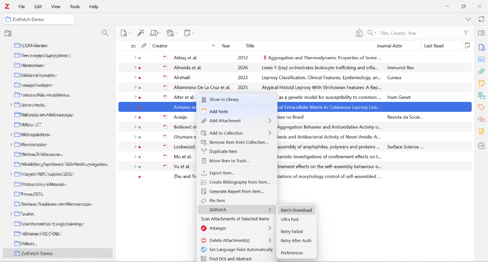

## Summary

Reference managers organize bibliographic records, but the associated articles may remain distributed across publisher websites and repositories. Retrieving these documents requires identifying an accessible copy, locating the actual file, and associating it with the correct library record. ZotFetch is a JavaScript plugin that coordinates these operations for batches of items selected in Zotero. For each selected record, the plugin checks for an existing PDF, searches for candidate copies when needed, and follows links from article pages to downloadable files. It attaches the retrieved document to the selected record. Progress reporting and targeted retries allow users to inspect unresolved items and resume retrieval after authentication.

ZotFetch is intended for researchers, students, and information professionals assembling literature collections for reading and evidence assessment. Its contribution is a modular retrieval workflow embedded in an existing reference manager. The software is distributed under the MIT license; this article describes version 1.6.6 [@dossi2026].

## Statement of need

The distribution of scholarly documents across heterogeneous services creates a distinction between identifying a publication and obtaining its full text. Open-access discovery services and aggregators address this problem by indexing copies held by publishers and repositories [@piwowar2018; @knoth2023]. However, a discovered location may identify an article webpage, require authentication, or no longer provide a downloadable document. Consequently, a bibliographic identifier or candidate URL is not sufficient evidence of successful acquisition.

ZotFetch addresses the transition from an existing Zotero collection to attached full-text documents. One intended application is retrieving reports selected for full-text assessment after title and abstract screening. The plugin coordinates retrieval attempts, preserves the parent–attachment relationship, and separates failed acquisition from successful import. It does not perform literature searching, eligibility assessment, or data extraction. If automated retrieval fails, reviewers can pursue other access routes. In a PRISMA 2020 flow diagram, reports that remain unavailable are counted separately from reports excluded after eligibility assessment [@rethlefsen2022]. Researchers remain responsible for checking document identity, publication version, and eligibility.

## State of the field

Zotero already provides PDF acquisition through its native retrieval mechanisms, including Unpaywall integration, and supports configurable HTML and JSON resolvers [@stillman2018; @zoteroResolvers]. ZotFetch extends this infrastructure rather than introducing batch PDF retrieval as a new capability . Unpaywall supplies locations of accessible copies, whereas CORE aggregates scholarly metadata and full texts; both provide resources that can be incorporated into retrieval workflows [@piwowar2018; @knoth2023].

A separate project, `nikhilweee/zotfetch`, also uses the name Zotfetch. That plugin retrieves missing files and reconnects them to existing attachment records to retain annotations when file synchronization is disabled [@verma2024]. The present software, `fdossi/zotfetch`, instead emphasizes orchestration across multiple sources, webpage-to-PDF resolution, and import into a selected bibliographic collection. These repository identifiers distinguish the projects unambiguously.

A single lookup rule can identify a candidate file. Processing a batch of selected records also requires deciding when to stop querying a host and which items to retry after authentication. Keeping those decisions in the extension allows multiple resolvers to share the outcome of a previous request to the same host. Implementing the workflow as a Zotero plugin retains the host application's library and attachment infrastructure while allowing source-specific behavior to evolve independently. This rationale establishes a functional distinction; it does not demonstrate superior retrieval coverage or speed relative to Zotero or other plugins.

## Software design

The implementation separates identifier extraction, candidate discovery, PDF resolution, and attachment import. The plugin reads digital object identifiers (DOIs), arXiv identifiers, and identifiers from PubMed and PubMed Central when present in the record. When a DOI is absent, the plugin can query Crossref by title, using author and year when available, and save a DOI to the parent record after a heuristic match; this step is omitted in Ultra Fast mode. A reviewer should verify that the recovered DOI identifies the intended work before relying on the attachment.

Source resolvers produce prioritized candidates representing direct PDF links, landing pages, or native Zotero acquisition paths [@dossi2026]. Implemented sources include Unpaywall, Semantic Scholar, OpenAlex, Europe PMC, CORE, repository links, DOI landing pages, and institutional proxy routes. Whether a candidate yields a document depends on the external service, the metadata supplied, and the user’s access at the time of retrieval. Version 1.6.6 also enables a built-in Sci-Hub resolver for eligible DOI-bearing records in the normal retrieval chain and supports conditional delegation to Sci-PDF custom resolvers. Accordingly, the release cannot be characterized as restricted to open-access or institutionally licensed sources; retrieval availability does not establish permission to access or reuse a document.

PDF resolution is separate from source discovery because the same landing-page structure can be encountered through different services. Resolution strategies include direct-file checks, publisher-specific extraction rules, generic HTML metadata and link extraction, and a hidden Gecko browser for supported JavaScript-rendered pages. The browser fallback can expose PDF links generated by JavaScript on supported publisher sites. Its behavior depends on the Zotero runtime and the page served during the request. Human-verification challenges remain a boundary requiring user intervention.

For the plugin-managed import path, the importer checks for a PDF signature within the first 1,024 bytes and stores the validated bytes through Zotero's attachment APIs. The importer reuses the response bytes when available, avoiding a second download of that response [@dossi2026]. Native Zotero acquisition follows separate host-application paths. Format validation detects some non-PDF responses; it does not establish that the document matches the intended publication or constitutes a complete, readable article.

Retrieval scheduling balances coverage against waiting time and repeated requests. Fast mode defers the configured Brazilian CAPES journal-access gateway to a second pass for unresolved items, whereas Ultra Fast mode omits that fallback. Per-domain spacing, backoff, and challenge-related cooldowns limit repeated requests to failing hosts. These mechanisms deliberately trade immediate retry opportunities for reduced request repetition; the mode names are interface labels rather than measured performance claims.

Credentials are stored through Zotero's Login Manager. Plugin-managed requests apply destination and redirect checks, including restrictions on private-network addresses, with a scoped exception for a configured institutional gateway. ZotFetch also limits its own URL logging. These controls have defined boundaries: pre-request DNS checks do not eliminate DNS rebinding, and Zotero's native network operations and debug logs retain their own behavior [@dossi2026].

## Research impact statement

The repository records releases and revisions in March, April, and October 2026, including changes to the retrieval pipeline, authentication handling, and Zotero compatibility [@dossi2026]. An external contribution by GitHub user BetoNetu introduced Zotero 10 compatibility work and preferences-panel changes through pull request 2 [@betonetu2026]. This contribution documents community involvement in maintaining ZotFetch. It also suggests that researchers outside the development team may find the plugin useful.

Version 1.6.6 includes pipeline and regression tests with mocked Zotero and HTTP behavior. Its release notes report 71 pipeline tests and 20 regression tests passing locally, together with manual testing on Zotero 10.0.6 under Windows 11 [@dossi2026]. These are maintainer-reported results, not an independent end-to-end validation. Zotero 8 and 9 were not retested for that release. The tests provide inspectable examples of expected behavior but do not measure retrieval accuracy or coverage on a representative literature corpus.

ZotFetch was developed by its author [@dossi2026], who routinely used the plugin to retrieve articles while preparing manuscripts that have since been submitted for publication. A video accompanying the LinkedIn announcement for version 1.6.6 demonstrates how ZotFetch retrieves articles and attaches them to records in a Zotero library [video demonstration] (https://youtu.be/4Yi7LZFjYqg), also see this [explaining video] (https://youtu.be/awRX5vfXO9Y).

# Figure

## AI usage disclosure

OpenAI ChatGPT/Codex assisted with coding, source inspection, and manuscript drafting. Technical statements were compared with the versioned source code, documentation, and release notes during preparation. Pull request 2 separately reports AI assistance as technical guidance during software development [@betonetu2026].

## Acknowledgements

The author acknowledges the Zotero developer community and the maintainers of the scholarly services used by the plugin. The author thanks BetoNetu for contributing Zotero 10 compatibility and revisions to the preferences interface through pull request 2.

This work received no funding or sponsorship.

## Conflicts of interest

The author declares no conflicts of interest.

## References

BetoNetu. 2026. “Zot10 Fix: Pull Request 2 in Fdossi/Zotfetch.” 2026. https://github.com/fdossi/zotfetch/pull/2.

Dossi, Fábio Cleisto Alda. 2026. “ZotFetch: Batch PDF Downloader for Zotero.” https://github.com/fdossi/zotfetch/releases/tag/1.6.6.

Knoth, Petr, Drahomira Herrmannova, Matteo Cancellieri, Lucas Anastasiou, Nancy Pontika, Samuel Pearce, Bikash Gyawali, and David Pride. 2023. “CORE: A Global Aggregation Service for Open Access Papers.” Scientific Data 10: 366. https://doi.org/10.1038/s41597-023-02208-w.

Piwowar, Heather, Jason Priem, Vincent Larivière, Juan Pablo Alperin, Lisa Matthias, Bree Norlander, Ashley Farley, Jevin West, and Stefanie Haustein. 2018. “The State of OA: A Large-Scale Analysis of the Prevalence and Impact of Open Access Articles.” PeerJ 6: e4375. https://doi.org/10.7717/peerj.4375.

Rethlefsen, Melissa L., and Matthew J. Page. 2022. “PRISMA 2020 and PRISMA-S: Common Questions on Tracking Records and the Flow Diagram.” Journal of the Medical Library Association 110 (2): 253–57. https://doi.org/10.5195/jmla.2022.1449.

Stillman, Dan. 2018. “Improved PDF Retrieval with Unpaywall Integration.” Zotero. October 9, 2018. https://www.zotero.org/blog/improved-pdf-retrieval-with-unpaywall-integration/.

Verma, Nikhil. 2024. “Zotfetch: Fetch and Relocate PDFs in Zotero 7.” February 29, 2024. https://nikhilweee.me/blog/2024/introducing-zotfetch/.

Zotero. n.d. “Custom PDF Resolvers.” Accessed November 5, 2026. https://www.zotero.org/support/kb/custom_pdf_resolvers.
